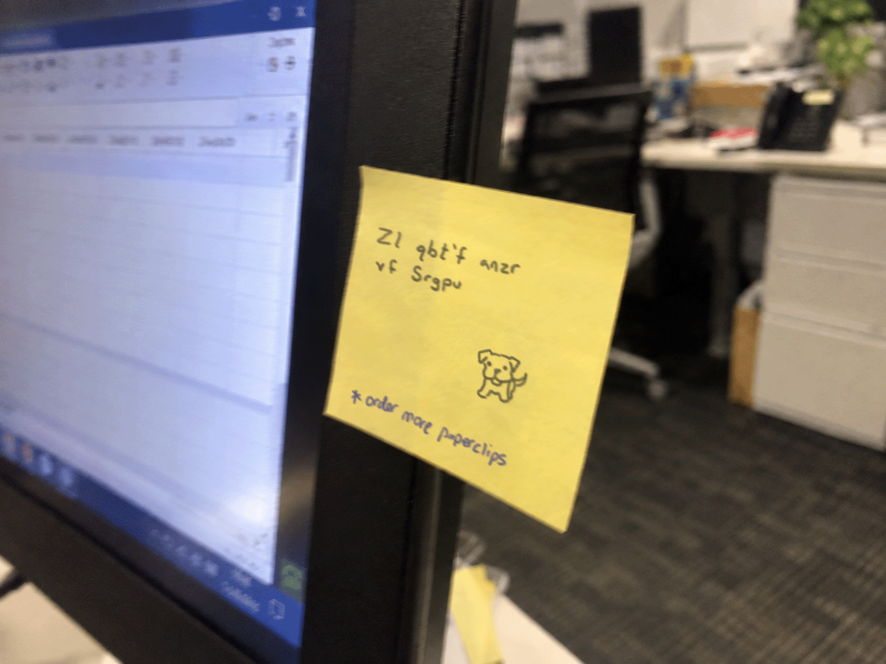

# Hail Caesar

Submit the flag with the dog's name as: deadface{dog's name}



Look sticky note on write `Zl qbt'f anzr vf Srgpu` Like ROT13 so i use so script to decode this crpyto

```python
import codecs

code = "Zl qbt'f anzr vf Srgpu"
decoded = codecs.decode(code, 'rot_13')

print(decoded)
```

```
My dog's name is Fetch
```
So Flag is  `deadface{Fetch}`

# Infrequent Emojis
Question 

https://doomscroll.dctf.io/post/252

# Admitted Under Another Name
